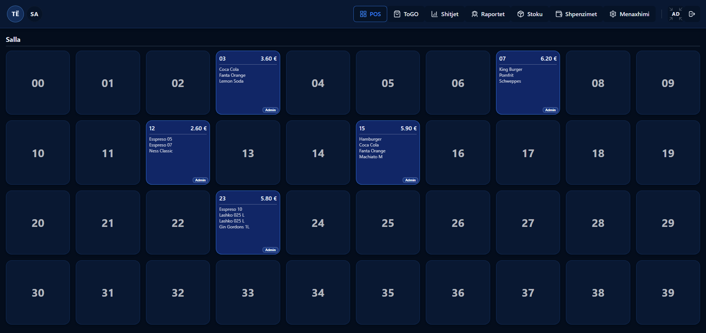
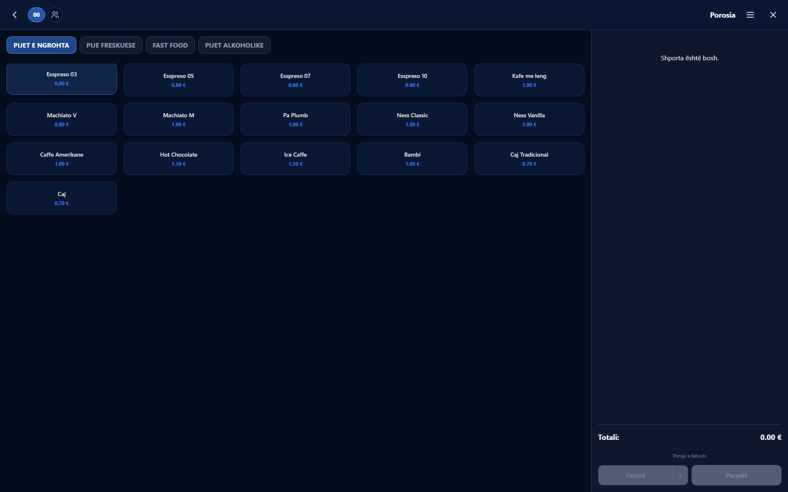
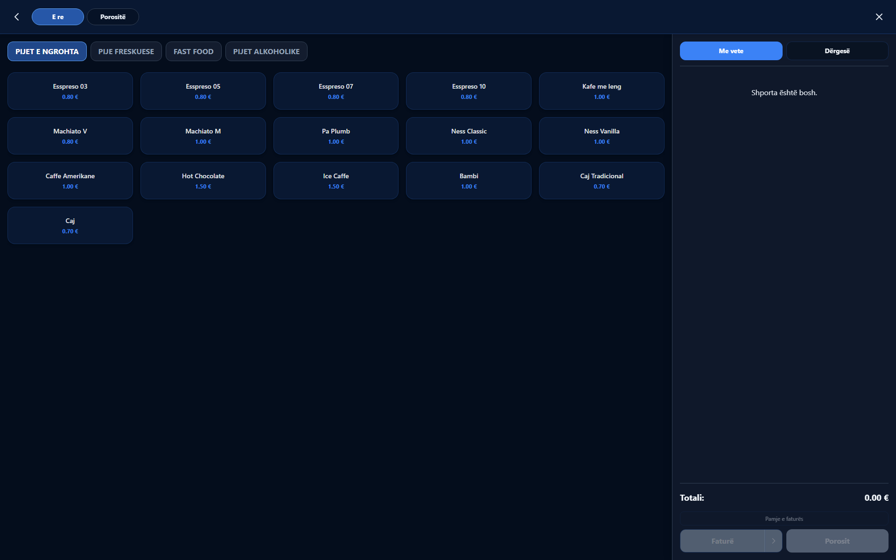
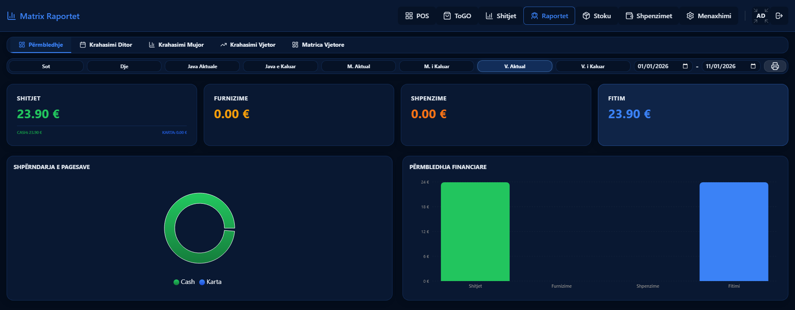
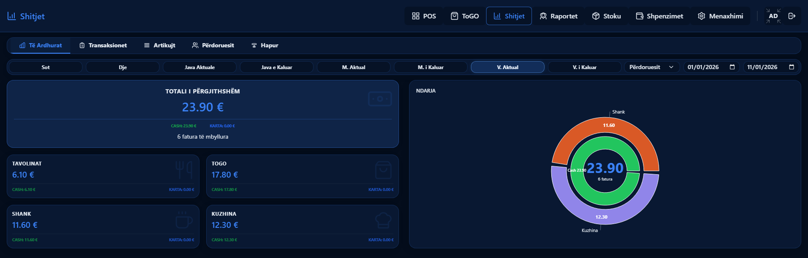
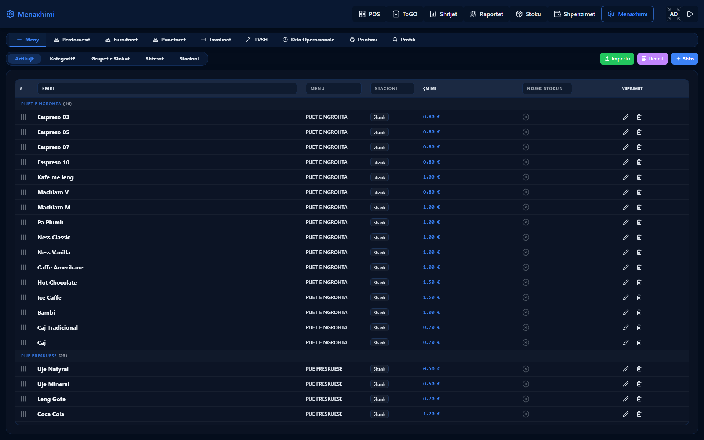

# XPOS

Point of sale and stock control for cafés, bars, restaurants and fast food in Kosovo. Built and sold.

The source is private. This page is the walkthrough.

---

## Local-first by design

XPOS runs on one PC inside the venue. Staff use it from their own phones and tablets over the local network, and it does not require an internet connection to operate.

That constraint shapes how the product is delivered as much as how it is built:

- The server is bundled with esbuild into a standalone Windows executable, packaged with PostgreSQL into an installer, and runs as a Windows service.
- The schema is created and migrated on startup, so every installation converges to the same structure with no manual SQL on site.
- A phone joins by scanning a QR code from the users screen.
- A device running a superseded build is prompted to reload, and the flag does not clear itself.
- Installed copies validate a licence key with an expiry date.

---

## The floor

Forty tables, five open. Each open table shows its total, its items and the user who opened it. State is synchronised across every connected device over websockets. Tables are grouped into sections, and a user can be restricted to specific sections.

---

## Taking an order

A table can be split between named guests. Each line records which user added it and at what time.

Items can carry reusable option groups with price deltas, opened by long press along with a kitchen note. The selected options are copied onto the order line at the time of sale, so later edits to an option's name or price do not alter completed sales. Kitchen notes print on the kitchen ticket and not on the receipt.

---

## Counter and delivery

Counter service is a shop-wide setting rather than a separate product. A café leaves it off; a fast food turns it on.

An order is either **Me vete** or **Dërgesë**. Delivery requires a phone, a name and an address, and a known phone number fills in the address last used. The order is assigned its number when it is sent to the kitchen, numbers restart each operational day, and a database advisory lock prevents two devices from being assigned the same number. The kitchen ticket prints the number in large type.

The setting cannot be switched off while orders remain open on it; the server refuses and reports how many.

---

## The operational day

`operational_day_start_hour` is a setting, five by default. Every period boundary in the system is derived from it, so a sale recorded at 01:30 falls on the previous business day across the sales screen, all reports and every export.

---

## Stock and cost

Stock tracking is enabled per item rather than globally, since most menu items are made to order and hold no countable inventory.

Cost is held as a weighted average, recomputed on each intake. One case is handled explicitly: when an item's recorded cost is zero because it predates cost tracking, the existing quantity is treated as carrying the new batch's unit cost rather than a zero, which would otherwise pull the average down and understate the cost of everything already in stock.

Two mechanisms sit on top. **Stock groups** let several menu items draw on a single count, so one coffee supply serves every drink made from it. **Përbërësit** records that selling one item consumes another, so a coffee with juice also deducts a water.

---

## Reporting

Sales, supplies and expenses, with the resulting profit. Comparisons by day, month and year, a year matrix, and cash separated from card.

Revenue, transactions, items and users over any period, split by tables against counter and by bar against kitchen. A recorded sale can be voided, discounted or comped, and each action is retained rather than deleting the sale.

---

## Configuration

Menu, categories, option groups, stock groups, users, suppliers, staff, table layout, VAT, the operational day and printing. Tickets are routed by station, so drinks print at the bar and food in the kitchen.

Search across the application uses one shared rule, case- and accent-insensitive, so `caj` matches **Çaj**. The rule is documented as being for matching only and not for identifiers or stored keys, since a matching rule can change and a stored key cannot.

---

## Stack

- React with TypeScript on Vite, Tailwind, Socket.IO. Installable as a PWA, laid out for phones, tablets and the desktop till.
- Node and Express with PostgreSQL accessed through raw SQL rather than an ORM, chosen for a single on-site machine rather than a cloud deployment.
- Thermal printing over ESC/POS, Sentry for error tracking, Albanian interface.

---

## Why this is a walkthrough and not a repository

XPOS is a commercial product with a paying client. I am happy to discuss the reasoning behind any of it: the local-first constraint, the operational day, the cost-averaging case above, or why an order line keeps its own copy of the options.

Enver Kollari · [github.com/enverkollari](https://github.com/enverkollari) · enverkollari@hotmail.com
